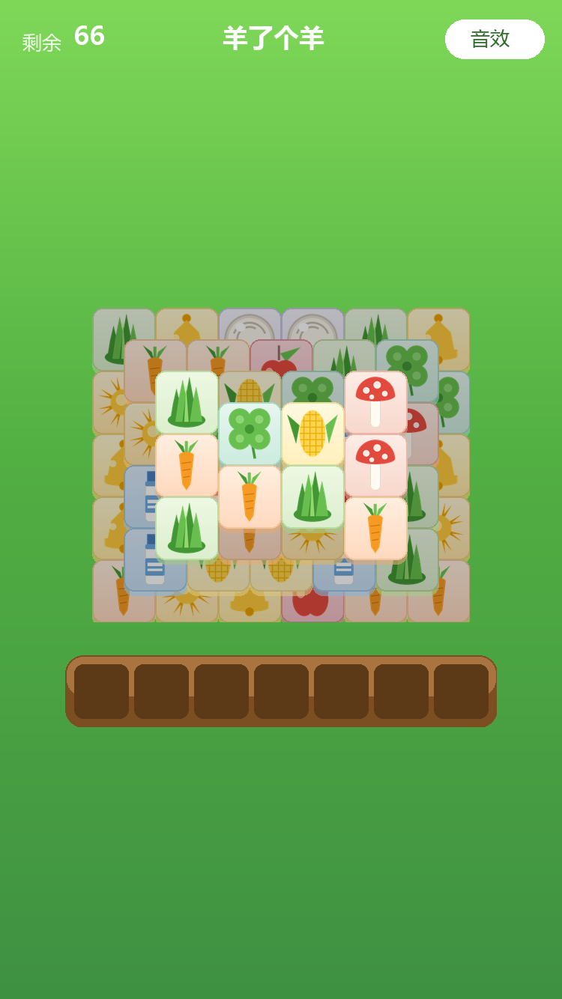

# 羊了个羊 · 核心玩法复刻（微信原生小程序）

test abc def

只做「进羊群」这条核心循环，排行榜、道具、关卡这些边缘功能全部砍掉。
纯前端，不依赖后端，不需要联网。



> 上图是用 Pillow 按 WXSS 的参数合成的**近似效果图**（牌堆位置和牌型是真实数据），不是真机截图。

## 玩法

1. 66 张牌分 **4 层**叠放，上层牌压住下层牌，被压住的点不动
2. 点一张没被压住的牌 → 掉进底部 **7 格卡槽**
3. 卡槽里同种牌凑够 **3 张**自动消除
4. 卡槽塞满 7 格还没消除 → **失败**
5. 所有牌消完 → **通关**

## 跑起来

1. 微信开发者工具 → 导入项目 → 目录选 **`D:\AIProject\sheep`**
2. AppID 用你自己的（已填 `wx554f1b2b3fff6ad0`）或点测试号
3. 直接编译，不用启动任何服务

> 项目根目录就有 `app.json`，不要选到它的上一层。

## 目录结构

```
sheep/
├─ app.js / app.json / app.wxss     小程序入口与全局样式
├─ project.config.json              已把 tools/ 排除出打包
├─ pages/game/                      唯一页面：牌桌
│  ├─ game.wxml                     牌堆 + 卡槽 + 结果弹窗
│  ├─ game.wxss                     米色牌面、木质卡槽、消除动画
│  └─ game.js                       渲染同步、点击、动画时序
├─ game/
│  ├─ logic.js                      纯逻辑：布局 / 叠压判定 / 牌型生成（无 wx 依赖）
│  └─ audio.js                      BGM 循环 + 音效复用
├─ assets/
│  ├─ icons/*.png                   11 个图标（10 种牌 + 小羊）
│  ├─ bgm.wav                       8 秒循环 BGM
│  └─ sfx/*.wav                     点击 / 消除 / 胜利 / 失败
└─ tools/
   ├─ gen_assets.py                 重新生成全部图片和音频
   ├─ render_preview.py             渲染 preview.png（配色/尺寸自检用）
   ├─ test_logic.js                 逻辑层回归测试
   └─ test_page.js                  页面层冒烟测试
```

## 牌面配色

每种牌有自己的浅色底，不用看图标也能一眼分出类型（`game.wxss` 的 `.tile--*`）：

| 牌 | 卡片底色 | 牌 | 卡片底色 |
|---|---|---|---|
| 胡萝卜 | 蜜桃橙 | 玉米 | 米黄 |
| 草 | 黄绿 | 蘑菇 | 粉橘 |
| 羊毛 | 淡紫 | 苹果 | 洋红 |
| 铃铛 | 金黄 | 太阳 | 琥珀 |
| 牛奶 | 天蓝（略深，白瓶子才看得清） | 四叶草 | 薄荷绿 |

配色都压在浅色区间，不会盖过图标的辨识度。改颜色要同步改两处——
`game.wxss` 的 `.tile--*` 和 `tools/render_preview.py` 的 `COLORS`，
然后跑一遍 `python tools/render_preview.py` 出图核对。

## 素材是脚本生成的

没有任何外部下载素材：

- **图标**：`tools/gen_assets.py` 用 Pillow 画（4 倍超采样再缩小，边缘才不锯齿）
- **BGM**：numpy 合成，120 BPM，4 小节 I–V–vi–IV 走向，主旋律 + 低音 + 琶音 + 轻打击，
  循环点做了淡入淡出避免爆音
- **音效**：4 个短 wav，点击是下滑音，消除是双音铃，胜负是上行/下行琶音

重新生成：

```powershell
# 需要 Pillow + numpy
python tools/gen_assets.py
```

## 关于「一定有解」

纯随机分配牌型，大概率生成**无解**牌局——这正是羊了个羊第 2 关被骂的原因。

这里的做法：

1. 先算一条合法取牌顺序：每次只从「当前没被压住」的牌里随机挑一张
2. 再沿着这条顺序把同种牌三张一组埋进去，并把若干组交错摆放（让三张不在同一时刻暴露）
3. 最后**回放验证**卡槽全程不超过 7 格，不通过就换一组重新埋

所以每个牌局都保证存在一条通关路径，但玩家不知道这条路径，该卡还是会卡。

## 调难度

改 `game/logic.js`：

| 参数 | 位置 | 说明 |
|---|---|---|
| `LAYERS` | 文件顶部 | 每层的行列数与半格偏移，改完总牌数必须是 3 的倍数 |
| `typeCount` | `createGame` 默认 10 | 牌型种数，越大越难 |
| `slotMax` | 默认 7 | 卡槽容量，调小更难 |

改完记得跑一遍测试。

## 自测

```powershell
node tools/test_logic.js   # 300 个牌局：结构、可解性、叠压、判负
node tools/test_page.js    # 页面层：开局 / 入槽 / 三消 / 通关 / 判负 / 重开
```

当前结果：300 个牌局全部可解、卡槽峰值 ≤ 6；页面层 9 项全过。

## 实现了什么 / 故意没做什么

**有**：分层叠压、点击入槽、三消、胜负判定、BGM、音效、静音开关、重开、消除/入槽动画、被压牌点不动的抖动反馈

**没有**（按需求砍掉）：道具（移出 / 撤销 / 洗牌）、排行榜、皮肤、关卡递进、道具购买

## 已知限制

- BGM 用 wav（脚本能直接合成，无需编码器）。个别老机型对 wav 支持一般，
  要更稳就把 `assets/bgm.wav` 转成 mp3，并改 `game/audio.js` 里的 `FILES.bgm`
- 开发者工具里如果系统音量/静音开关影响，可能听不到声音，真机正常
- 没有做进度存档，退出即重开
- 卡牌拖拽、飞入卡槽的位移动画没做，目前是「入槽缩放 + 消除放大淡出」
- 牌堆是 4 层「半格错位」堆叠，没有做原版那种同一位置垂直叠好几张的小堆（视觉上会互相完全遮住，需要额外做像素级错位才能看出张数）
